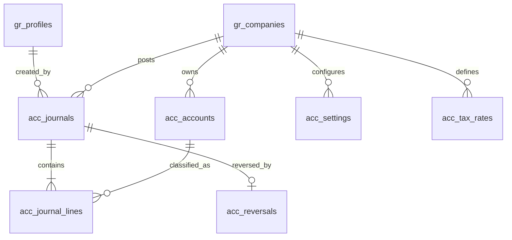

# Accounts Module — Phase 1 (ledger foundation)
**Repository:** GreenRich ONE (Supabase Auth + PostgreSQL + static JavaScript UI).
**Branch:** feature/accounts-phase1-ledger. This is a reviewable foundation, **not production-ready accounting**.

## Installation
1. Back up the production database. Test first in a separate Supabase project.
2. Ensure the latest CRM migrations are installed, including `gr_companies` and `gr_profiles.company_ids`.
3. Run `001_foundation.sql`, then `002_reversal_period_reports.sql` in the Supabase SQL Editor.
4. Run `003_smoke_checks.sql`; verify it completes without exceptions.
5. Deploy branch UI to a test site; log in as Accounts/Admin and visit **Accounts**. Choose one company (not Both Companies) to inspect its ledger.
6. Check RLS manually with an Accounts user restricted to one company before any live postings.

## Folder layout
- `001_foundation.sql` — company settings, accounts, taxes, payment terms, sequences, journal lines, RLS, ledger posting.
- `002_reversal_period_reports.sql` — reversal records, month locking RPC and trial balance view.
- `003_smoke_checks.sql` — seeded accounts and journal/trial-balance checks.
- `accounts-ui.js` — read-only chart of accounts, journal and trial balance screens.

## Data relationships

## Posting boundary
`acc_post_journal(company,date,source_type,source_id,memo,lines,currency)` is atomic (one PostgreSQL transaction per RPC), validates permissions, company accounts, exact 2-decimal amounts, positive single-sided journal lines, unique source and balanced totals. It allocates numbers after validation inside the transaction; failed transactions roll the counter back. Company advisory transaction locks serialize posting with month locking.
`acc_reverse_journal(journal,reason)` posts reversing lines dated today, retains original rows, records a unique reversal link.
`acc_set_period_lock(company,first_day_of_month,lock)` locks/unlocks a calendar month.
Use read-only `acc_trial_balance` for a current cumulative trial balance (date-range filtering is not implemented in Phase 1).

## Known blockers for production
- The current RPC accepts caller-selected lines and source identifiers; it is only suitable as a **manual-journal foundation**. Before invoice/bill posting, add trusted document-specific server-side validation and dispatch through one private ledger core. Do not allow clients to impersonate sales/purchase documents.
- Phase 1 has no invoice, bill, payment, PO, petty cash, period-lock screen, approval workflow, reports hub, document PDF, OpenAPI REST wrapper, or MCP tools. These belong to later phases.
- No automatic GST treatment or input-tax eligibility validation is implemented. GST seed rates are illustrative; validate CGST/SGST/IGST, intra/interstate, reverse charge, and applicable rates before issuing tax invoices.
- Tests are SQL smoke checks, not full permission/concurrency integration tests. API-side IP audit, idempotency keys, and disaster recovery procedures need implementation.
- Database migrations intentionally must be applied by an administrator; committing SQL does not execute it.

## Next phases
2. Sales docs, allocations, tax calculations, PDF.
3. Purchases, receipts, three-way match.
4. Petty cash and expenses.
5. Banking and reconciliation.
6. Ledger-driven reports/export.
7. Approval controls, audit completeness, automated integration testing and release hardening.
